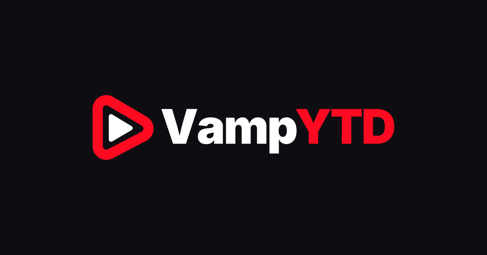

<p align="center">
  
</p>

<p align="center">
  <a href="https://github.com/vampdued/vampytd/releases"></a>
  
  
  
  
</p>

Unified high-performance YouTube downloader and Chrome Native Messaging Bridge with embedded Ratatui & Nucleo fuzzy terminal UI.

This repository is a **monorepo** containing both the core Rust CLI / native messaging engine and the Manifest V3 browser extension.

---

## 📁 Repository Structure

```
vampytd/
├── src/                  # Core Rust engine & Native Messaging host
│   ├── bridge.rs         # Browser extension communication bridge (stdin/stdout JSON)
│   ├── colorizer.rs      # ANSI real-time terminal download stream colorizer
│   ├── config.rs         # User configuration & cookie management
│   ├── deps.rs           # Dependency validation (yt-dlp, ffmpeg, JS runtimes)
│   ├── downloader.rs     # Stream sorting, HDR/language detection & yt-dlp execution
│   ├── main.rs           # CLI argument parsing & command dispatch
│   ├── notify.rs         # Native Windows toast notifications (WinRT)
│   └── tui.rs            # Interactive Ratatui + Nucleo fuzzy format picker (Vamp theme)
├── extension/            # Chrome / Brave / Edge browser extension (Manifest V3)
│   ├── background.js     # Background service worker & native port manager
│   ├── content.js        # YouTube in-page UI enhancements & context menus
│   ├── manifest.json     # Extension manifest with fixed deterministic ID
│   ├── popup.html/js     # Extension popup dashboard, tool diagnostics & Inter fonts
│   ├── fonts/            # Offline bundled Inter OTF font family
│   └── icons/            # Theme-adaptive SVG vector logos & PNG icons
├── assets/               # Brand assets, multi-res .ico, and social cards
├── build.rs              # Windows resource compiler embedding .ico into vampytd.exe
├── install.ps1           # Automated build, registry registration & deployment script
└── Cargo.toml            # Rust workspace dependencies & release profile
```

---

## 🌟 Key Features

- 🚀 **Unified Single Binary**: Combines both the interactive CLI downloader and the Chrome/Edge Native Messaging Bridge into one standalone `vampytd.exe`.
- 🔍 **Embedded Fuzzy Selector (No external `fzf` required)**: Features a custom YouTube Crimson-themed TUI powered by **Ratatui** and **Nucleo-Matcher** (the multi-threaded fuzzy engine behind the Helix editor).
- 🎨 **Dynamic Stream Inspector**:
  - **YouTube Premium Stream Detection**: Detects format `616` (1080p Enhanced Bitrate) with `[PREM]` gold badging and top-tier ranking.
  - **Filesize Estimation**: Calculates approximate sizes (`~XX.X MB`) for adaptive/HLS streams missing Content-Length headers.
  - **Delivery Protocol Column (`PROTO`)**: Clear tagging for `https`, `m3u8`, and `dash` streams.
  - **Rich Audio Diagnostics**: Detailed sampling rates and audio channels (e.g. `Opus 48k [hi]`, `AAC 48k 5.1 [en]`).
  - **Smart Codec Ranking**: Quality sorting using efficiency multipliers (AV1 2.0x, VP9/HEVC 1.45x, H.264 1.0x).
  - Pure numeric bitrate column (`2540k`, `128k`) indexed for fuzzy searching.
  - Vibrant **`4K 2160p HDR`** badges with automatic dynamic range detection.
  - Multi-track language tagging (e.g. `Opus [en]`, `AAC [hi]`).
  - Real-time auto-pairing status line previewing the exact audio track that pairs with the highlighted video stream.
- ⚡ **Zero Subprocess Overhead**: Replaces external `fzf.exe` and PowerShell toast processes with native Rust and WinRT notification APIs.
- 🍪 **Smart Cookie Management & Sanitizer**:
  - Automatically strips third-party ad/tracking telemetry (DoubleClick, Analytics) and retains essential authentication tokens (`LOGIN_INFO`, `SID`, `HSID`, `SSID`).
  - 1-click file import & drag-and-drop right inside the Chrome/Edge extension popup.
  - Built-in `vampytd cookies status` CLI audit tool reporting session validity, token checklists, and days remaining.
- 🎬 **Multi-Stream Selection**: Easily select and combine video and audio streams with keyboard navigation (`Spacebar` to tag, `Enter` to confirm).
- 🌐 **Seamless Browser Extension Bridge**: One-click download trigger directly from YouTube pages in Chrome, Brave, and Edge via Chrome Native Messaging.

---

## 🚀 One-Line Direct Install (via GitHub CLI)

If you have the GitHub CLI (`gh`) logged in, you can download, extract, and register the latest VampYTD release binary and Chrome extension with a single command:

```powershell
gh release download -R vampdued/vampytd --pattern "*.zip" --dir "$env:TEMP\VampYTD-Install" --clobber; Expand-Archive "$env:TEMP\VampYTD-Install\*.zip" -DestinationPath "$env:TEMP\VampYTD-Install\extracted" -Force; & "$env:TEMP\VampYTD-Install\extracted\install.ps1" -SkipBuild; Remove-Item "$env:TEMP\VampYTD-Install" -Recurse -Force
```

---

## 🛠️ Local Source Installation

Run the PowerShell installer to build the release binary, copy it to `%LOCALAPPDATA%\VampYTD`, and register the Native Messaging host in the Windows Registry:

```powershell
.\install.ps1
```

To skip rebuilding the binary when deploying changes:
```powershell
.\install.ps1 -SkipBuild
```

### Loading the Chrome Extension:
1. Open **`chrome://extensions`** (or **`edge://extensions`** / **`brave://extensions`**).
2. Enable **Developer mode** (top-right toggle).
3. Click **Load unpacked** and select the `vampytd\extension` folder.

---

## ⌨️ TUI Keyboard Controls

When running in interactive mode, the terminal opens the stream selector:

| Key | Action |
| :--- | :--- |
| `↑` / `k`, `↓` / `j` | Move selection up / down |
| `/` | Focus search bar (type filter text) |
| `v` | Filter to Video-only streams |
| `a` | Filter to Audio-only streams |
| `h` | Filter to HD+ streams (1080p and above) |
| `c` | Reset active filter |
| `Space` | Tag / untag highlighted stream for custom multi-stream merge |
| `Enter` | Download highlighted stream (or combined tagged streams) |
| `Esc` / `q` | Cancel / Exit |

---

## 💻 CLI Usage

### Interactive Mode (Default)
```powershell
vampytd https://www.youtube.com/watch?v=VIDEO_ID
```

### Quick Modes
```powershell
# Best quality available
vampytd https://www.youtube.com/watch?v=VIDEO_ID --mode quick-max

# Full HD (1080p)
vampytd https://www.youtube.com/watch?v=VIDEO_ID --mode quick-1080p

# Ultra HD (4K)
vampytd https://www.youtube.com/watch?v=VIDEO_ID --mode quick-4k
```

### Playlists
```powershell
# Single video from a playlist URL (default — strips playlist params)
vampytd "https://www.youtube.com/watch?v=VIDEO_ID&list=PLAYLIST_ID"

# Full playlist
vampytd "https://www.youtube.com/playlist?list=PLAYLIST_ID" --playlist

# Specific playlist items (e.g. items 1 to 5)
vampytd https://www.youtube.com/playlist?list=PLAYLIST_ID --playlist --items 1-5
```

### Update yt-dlp
```powershell
vampytd update
```

### Cookie Management (Sanitized Auth)
```powershell
# Audit health and validity of saved cookies
vampytd cookies status

# Sanitize and import any Netscape cookies.txt file
vampytd cookies import "C:\path\to\downloaded_cookies.txt"

# Clear saved cookies
vampytd cookies clear
```

### Native Messaging Host Mode (Automated)
```powershell
vampytd bridge
```
*Invoked automatically by the browser extension via standard I/O length-prefixed JSON.*

---

## 📄 License

MIT
